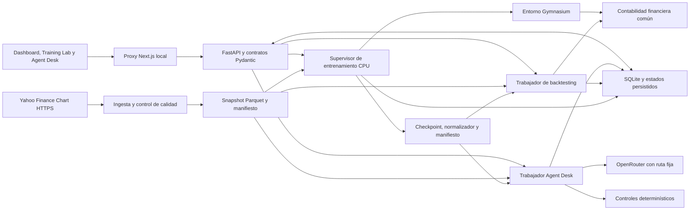

# Desarrollo de la ingeniería del prototipo Portfolio AI Lab

La implementación materializó los cuatro módulos de la Fase 3 —datos, simulación, agentes de aprendizaje por refuerzo y evaluación— en una plataforma local para estudiar la asignación dinámica de diez activos líquidos. El prototipo integra los modelos PPO y DDPG con referencias equiponderada y de Markowitz bajo un motor contable común. Una API y un tablero permiten configurar experimentos, consultar su estado y recuperar resultados con su procedencia. La demostración se realiza en modo PAPER con capital simulado. El escritorio de agentes con modelos de lenguaje amplía la inspección de propuestas y se mantiene separado de la evaluación cuantitativa.

## Metodología de desarrollo tecnológico

El proyecto mantiene el enfoque cuantitativo aplicado y el ciclo CDIO formulado en los apartados «Metodología de investigación» y «Metodología de desarrollo tecnológico» de la Fase 3. La etapa **Concebir** precisó el problema, el universo de activos, las métricas y el diseño experimental. En **Diseñar**, el prototipo se descompuso en módulos y se definieron contratos para fechas, observaciones, acciones y resultados. En **Implementar**, se construyeron la ingesta, el entorno, los algoritmos de referencia y los agentes PPO y DDPG. En **Operar**, el sistema se ejecutó localmente con datos históricos, se verificó la comunicación entre componentes y se conservaron resultados, trazas y capturas. Esta etapa describe la operación experimental del prototipo y se circunscribe al entorno local. [Arquitectura](../../architecture.md) · [Validación técnica](../../validation-report.md).

La Fase 3 propuso Scrum como marco de desarrollo, con iteraciones de dos semanas y un cronograma general de seis meses. Definió como responsabilidades previstas a Martín Castrillón Vásquez en la función de *Product Owner*, a Eduardo Jesús Daza Cañizares y Eliana Marcela Monsalve López en la función de desarrollo y una rotación de *Scrum Master*. El backlog inicial organizó seis épicas: Datos, Entorno, Agente y Evaluación con prioridad alta, y Benchmarks y Reporte con prioridad media. En el marco de Scrum, una iteración tiene un objetivo y produce un incremento cuya calidad puede inspeccionarse. Los roles, eventos y artefactos requieren respaldo del equipo. [Guía de Scrum de Schwaber y Sutherland (2020)](https://scrumguides.org/scrum-guide.html).

El registro técnico permite constatar una ejecución incremental con contratos previos, responsables por archivos, verificación de resultados e integración de componentes. El plan registra los criterios de aceptación y el informe de validación documenta pruebas observadas. El repositorio carece de actas, objetivos de sprint fechados, retrospectivas y evidencia de la rotación de *Scrum Master*. En consecuencia, la tabla registra incrementos de ingeniería y su relación con el backlog. Para acreditar el desarrollo formal de Scrum en el documento maestro, el equipo debe adjuntar los registros reales que conserve. La cronología técnica de las etapas y la duración prevista de los sprints corresponden a registros distintos. [Plan técnico](../../development-plan.md) · [Registro de agentes](../../AGENT-SWARM.md) · [Informe de validación](../../validation-report.md).

**Tabla 1. Incrementos de ingeniería vinculados con el backlog de la Fase 3**

| Incremento técnico | Épicas atendidas | Entregable y criterio observado |
|---|---|---|
| Etapas 0 y 1. Preparación e integración inicial | Datos, Reporte | Entornos locales, contratos y flujo navegador–API–trabajador–SQLite–navegador. La primera prueba integral usó una fixture sintética etiquetada. |
| Etapa 2. Datos y simulación histórica | Datos, Entorno, Benchmarks | Snapshot de diez activos, verificación de calendario, motor contable y comparación reproducible de equiponderado y Markowitz. Se ejecutaron comprobaciones de Gymnasium y SB3. |
| Etapa 3. Entrenamiento y evaluación | Agente, Evaluación, Benchmarks, Reporte | Checkpoints PPO y DDPG, selección cronológica de candidatos, comparación de cuatro estrategias en validación y reanudación comprobada de entrenamientos. |
| Etapa 4 técnica. Escritorio de agentes | Reporte y extensión del prototipo | Propuesta de asignación, dictamen estructurado, controles de riesgo y auditoría persistente. El registro incluye pruebas con proveedor simulado e inferencia autenticada con NVIDIA. |

Codex se utilizó como herramienta de implementación y revisión. El registro técnico documenta, por ejemplo, especialistas en datos, optimización y simulación durante la Etapa 2, tareas de PPO, DDPG, evaluación y aseguramiento de calidad durante la Etapa 3, y tareas de proveedor, flujo y riesgo durante la Etapa 4. La integración mantuvo propiedad exclusiva sobre archivos y contratos comunes. Estos registros identifican la actividad de los agentes de software. La participación de cada investigador en la actividad académica se documenta con las evidencias humanas correspondientes. [Registro de trabajo y propiedad](../../AGENT-SWARM.md) · [Contrato de Etapa 2](../../STAGE2-CONTRACTS.md) · [Contrato de Etapa 3](../../STAGE3-CONTRACTS.md) · [Contrato de Etapa 4](../../STAGE4-CONTRACTS.md).

## Análisis de requerimientos

La matriz conserva los identificadores y el enunciado de las tablas de la Fase 3. El estado «Verificado» se refiere a una comprobación local con el alcance que indica la última columna. «Parcial» identifica una parte del requerimiento cuyo resultado aún no está demostrado. El conjunto final de 2024 permanece reservado bajo el protocolo vigente. [Registro de trazabilidad](../../UNAD-PHASE4-EVIDENCE.md).

**Tabla 2. Trazabilidad de los requerimientos funcionales de la Fase 3**

| ID | Requerimiento de la Fase 3 | Módulo implementado | Estado | Evidencia | Resultado de verificación |
|---|---|---|---|---|---|
| RF1 | El sistema debe descargar y almacenar series históricas diarias de precios de los diez activos seleccionados. | `market_data` | Verificado | [Registro de ingesta](../../evidence/stage2/pipeline-progress.json) | Diez instrumentos, respuestas del proveedor y snapshot local con control de integridad. |
| RF2 | El sistema debe limpiar los datos y calcular retornos e indicadores técnicos. | `market_data`, `portfolio_env`, `portfolio_research` | Parcial | [Calidad](../../evidence/stage2/data-quality.json) y [entorno](../../../packages/portfolio_env/environment.py) | Validación de series, retornos simples y logarítmicos y estadísticas de volatilidad. La observación del agente no incorpora indicadores técnicos adicionales. |
| RF3 | El sistema debe dividir los datos cronológicamente en entrenamiento, validación y prueba. | `market_data`, `portfolio_evaluation` | Verificado | [Protocolo temporal](../../DATA-PROTOCOL.md) y [pruebas de evaluación](../../../tests/evaluation/test_replay.py) | Particiones disjuntas de 2015–2021, 2022–2023 y 2024. La tercera está reservada. |
| RF4 | El sistema debe simular el mercado como un MDP con costos de transacción. | `portfolio_env`, `portfolio_core` | Verificado | [Validación histórica](../../evidence/stage2/historical-validation.json) y [contabilidad](../../../packages/portfolio_core/accounting.py) | Entorno compatible con Gymnasium/SB3, transición y comisiones comprobadas mediante simulación histórica. |
| RF5 | El sistema debe entrenar un agente PPO y un agente DDPG sobre el mismo entorno. | `portfolio_rl`, `portfolio_env` | Verificado | [Estudio de entrenamiento](../../evidence/stage3/historical-study.json) | Ambas políticas se entrenaron con el entorno común y produjeron checkpoints evaluables. |
| RF6 | El sistema debe ejecutar la validación walk-forward sobre los datos de desarrollo (2015–2023) para analizar la estabilidad de los modelos. | `portfolio_evaluation`, `run_stage3.py` | Verificado para el diseño ejecutado | [Configuración](../../../experiments/stage3-protocol.json) y [resultados](../../evidence/stage3/historical-study.json) | Dos cortes walk-forward previos a 2022 para seleccionar candidatos y validación independiente en 2022–2023. La evidencia cubre esos cortes. |
| RF7 | El sistema debe ejecutar el backtesting final sobre el conjunto de prueba (2024) sin modificar los hiperparámetros. | Barreras de `portfolio_evaluation` y API | Pendiente | [Protocolo temporal](../../DATA-PROTOCOL.md) y [regresión API](../../../tests/api/test_historical_api.py) | Se verificó la protección de 2024. La evaluación final requiere aprobación del protocolo y sigue pendiente. |
| RF8 | El sistema debe calcular ratio de Sharpe, retorno acumulado, volatilidad anualizada y máximo drawdown. | `portfolio_core`, `portfolio_evaluation` | Verificado | [Contabilidad](../../../packages/portfolio_core/accounting.py) y [estudio](../../evidence/stage3/historical-study.json) | Métricas calculadas sobre curvas netas de costos con convenciones documentadas. |
| RF9 | El sistema debe construir los portafolios de referencia (equiponderado y Markowitz) usando únicamente información disponible hasta cada fecha de decisión. | `portfolio_research` | Verificado en causalidad algorítmica | [Pruebas de replay](../../../tests/research/test_backtest.py) y [validación histórica](../../evidence/stage2/historical-validation.json) | Ventanas rezagadas y repetición de ambas referencias. Persiste la limitación del ajuste retrospectivo del proveedor. |
| RF10 | El sistema debe comparar a los agentes contra los dos benchmarks bajo los mismos activos, capital inicial, frecuencia de rebalanceo y costos. | `portfolio_evaluation` | Verificado en validación | [Estudio](../../evidence/stage3/historical-study.json) y [comparación en el navegador](../../evidence/stage3/training-comparison-1440.png) | Cuatro estrategias con calendario, universo, contabilidad y supuestos económicos comunes. |
| RF11 | El sistema debe permitir configurar parámetros (costos de transacción, tasa libre de riesgo, hiperparámetros y semilla) desde un archivo de configuración. | `experiments`, `portfolio_rl.config` | Verificado | [Baseline](../../../experiments/stage2-baseline.json), [protocolo RL](../../../experiments/stage3-protocol.json) y [esquema de entrenamiento](../../../packages/portfolio_rl/config.py) | Perfiles JSON y parámetros tipados. Las ejecuciones conservan la configuración efectiva. |
| RF12 | El sistema debe generar tablas y gráficas con los resultados comparativos. | `dashboard.tsx`, `training-lab.tsx`, `equity-chart.tsx` | Verificado | [Comparación](../../evidence/stage3/training-comparison-1440.png) y [replay PPO](../../evidence/stage3/training-replay-ppo-1440.png) | Tabla de cuatro estrategias y gráficas de valor de portafolio por ejecución. |

**Tabla 3. Trazabilidad de los requerimientos no funcionales de la Fase 3**

| ID | Requerimiento de la Fase 3 | Módulo implementado | Estado | Evidencia | Resultado de verificación |
|---|---|---|---|---|---|
| RNF1 | Reproducibilidad: semillas fijas, versiones de librerías documentadas y código versionado. | `portfolio_rl`, manifiestos, `uv.lock`, `pnpm-lock.yaml` | Parcial | [Reproducibilidad](../../evidence/stage3/reproducibility.json) · [dependencias Python](../../../uv.lock) · [dependencias web](../../../pnpm-lock.yaml) | Repeticiones históricas concordantes en el mismo entorno y versiones declaradas. El repositorio local aún carece de un commit trazable. |
| RNF2 | Ausencia de fuga de información: ningún dato posterior a una fecha puede usarse para decidir en esa fecha. | `portfolio_env`, `portfolio_evaluation`, `agent_desk` | Verificado en causalidad algorítmica | [Protocolo temporal](../../DATA-PROTOCOL.md) y [pruebas del flujo](../../../tests/agent_desk/test_workflow.py) | Rezago de la observación, normalización ajustada en entrenamiento, aislamiento de la muestra final y pruebas de perturbación temporal. Las revisiones retrospectivas del proveedor no se sometieron a validación de versiones históricas. |
| RNF3 | Modularidad: módulos separados para datos, entorno, agente y evaluación. | Paquetes Python, API y aplicación web | Verificado | [Arquitectura](../../architecture.md) y [contrato RL](../../STAGE3-CONTRACTS.md) | Separación por paquetes y contratos, con pruebas de integración. |
| RNF4 | Documentación: código comentado y cuaderno de ejecución comprensible. | Documentación técnica y scripts | Parcial | [Runbook](../../RUNBOOK.md) y [script experimental](../../../scripts/run_stage3.py) | Código documentado y procedimiento local reproducible. Falta el cuaderno de ejecución planteado en la Fase 3. |
| RNF5 | Rendimiento: el entrenamiento debe poder ejecutarse en Google Colab con los recursos disponibles. | Entrenamiento local en CPU | Pendiente de verificación | [Configuración y límites](../../../experiments/stage3-protocol.json) y [mediciones del estudio](../../evidence/stage3/historical-study.json) | Se registraron ejecuciones locales con límites de memoria y tiempo. Falta evidencia de ejecución en Colab. |

## Diseño integral del prototipo

El diseño preliminar identificaba un flujo de datos hacia el entorno, los agentes de aprendizaje y la evaluación. En la implementación, `portfolio_core` concentra la contabilidad y las restricciones matemáticas compartidas por el entorno y los benchmarks. Los módulos de entrenamiento y evaluación consumen ese núcleo. La API agrega coordinación, validación de contratos y persistencia, mientras que la interfaz presenta métricas calculadas en Python. Esta separación permite comparar políticas con reglas económicas comunes y ejecutar los trabajos de aprendizaje sin bloquear el ciclo HTTP. [Arquitectura](../../architecture.md) · [Contratos HTTP generados](../../../packages/contracts/openapi.json).

**Figura 1. Arquitectura implementada y recorrido de los datos**

*Nota.* La ingesta se ejecuta fuera de las solicitudes HTTP. El acceso a OpenRouter corresponde al escritorio de agentes. La validación de las estrategias financieras emplea datos y artefactos locales. Elaboración propia a partir de la arquitectura del repositorio.

**Tabla 4. Tecnologías y responsabilidades en la implementación**

| Componente | Tecnologías efectivas | Responsabilidad y artefacto |
|---|---|---|
| Captura y validación de datos | Python, cliente HTTP, NumPy, pandas, PyArrow, exchange-calendars | `market_data` consulta Yahoo Finance Chart, alinea sesiones y almacena precios, respuestas y reportes verificables. |
| Cálculo financiero | NumPy y SciPy | `portfolio_core` calcula transiciones y métricas. `portfolio_research` implementa equiponderado y optimización media-varianza. |
| Entorno y modelos | Gymnasium, Stable-Baselines3, PyTorch en CPU | `portfolio_env` simula la asignación diaria. `portfolio_rl` entrena PPO/DDPG y conserva políticas y normalizadores. |
| Evaluación | Python, NumPy y contratos del motor | `portfolio_evaluation` construye ventanas cronológicas, reproduce políticas congeladas y agrega resultados por semilla. |
| Backend y almacenamiento | FastAPI, Pydantic, Uvicorn y SQLite | API tipada, procesos de trabajo, transacciones y recuperación de resultados, con manifiestos locales para artefactos binarios. |
| Frontend | Next.js App Router, React, TypeScript, Tailwind CSS y shadcn/ui | Configuración, historial, curvas, asignaciones, comparación y auditoría a través de un proxy local con rutas permitidas. |
| Escritorio de agentes | HTTPX, OpenRouter, Pydantic y reglas Python | Analista, estratega cuantitativo, Judge y coordinador. Conserva trazas del proveedor y resultados de las puertas de riesgo. |
| Reproducibilidad y calidad | Python 3.11, Node local, uv, pnpm, pytest y Playwright | Dependencias fijadas, comandos de ejecución y pruebas de código, API y navegador. |

La Fase 3 contempló `yfinance` con Alpha Vantage como alternativa, un cuaderno Jupyter/Google Colab y GitHub. La captura verificada se realizó mediante el endpoint Chart de Yahoo Finance por HTTPS, el entrenamiento se ejecutó en CPU local con scripts y el código permanece en el repositorio local. Python, NumPy, pandas, Gymnasium, Stable-Baselines3 y PyTorch se conservaron en los módulos de investigación. FastAPI, Next.js y SQLite ampliaron la arquitectura para integrar el prototipo y facilitar su demostración. La publicación, el cuaderno y la ejecución en Colab deben distinguirse de la implementación local ya comprobada. [Protocolo de datos](../../DATA-PROTOCOL.md) · [Runbook](../../RUNBOOK.md).

## Desarrollo e implementación

### Datos históricos y controles de calidad

La ingesta consulta AAPL, MSFT, JPM, JNJ, XOM, PG, KO, WMT, SPY y GLD. Conserva las respuestas JSON, los parámetros de captura, las fechas de descarga y las huellas SHA-256. La validación usa XNYS como calendario común de sesiones y comprueba cobertura, orden, duplicados, completitud, valores finitos, precios positivos y consistencia básica de los campos bursátiles y acciones corporativas. La ingesta rechaza series incompletas y conserva evidencia de los fallos. El archivo de trabajo contiene cierres ajustados alineados. Otro Parquet conserva barras del proveedor con precios, volumen y acciones corporativas. [Código de ingesta](../../../packages/market_data/pipeline.py) · [Informe de calidad](../../evidence/stage2/data-quality.json).

El snapshot documentado comprende 2.516 sesiones entre el 2 de enero de 2015 y el 31 de diciembre de 2024. Las particiones de entrenamiento, validación y prueba final contienen respectivamente 1.763, 501 y 252 sesiones. Los cierres ajustados permiten calcular retornos con los efectos de dividendos y desdoblamientos ya incorporados por el proveedor. El motor evita añadir esos efectos por segunda vez. El ajuste retrospectivo limita lo que puede afirmarse sobre la disponibilidad histórica exacta de la serie observada. La composición fija de la muestra y el calendario común constituyen otros supuestos metodológicos. La partición de 2024 se ingirió y pasó controles de calidad. Sigue excluida de ajuste, selección, evaluación y demostración. [Protocolo y particiones](../../DATA-PROTOCOL.md).

### Entorno de simulación y motor de backtesting

El estado interno del simulador conserva el valor de la cartera, los pesos que resultan del movimiento de precios y el índice temporal. La observación entregada a la política reúne los retornos logarítmicos rezagados de los diez activos y los últimos pesos objetivo conocidos. Con una ventana de 60 retornos, la observación contiene 610 componentes. Al inicio, el vector de pesos observados está en cero para representar capital en efectivo. El estado planteado en la Fase 3 incluía precios e indicadores técnicos. La realización usa retornos logarítmicos y pesos conocidos para limitar la entrada a información elegible. Los pesos efectivos al cierre de ejecución permanecen en el simulador para calcular costos. [Entorno implementado](../../../packages/portfolio_env/environment.py) · [Interfaz de Gymnasium](https://gymnasium.farama.org/api/env/).

La acción cruda pertenece a un espacio continuo de diez dimensiones en el intervalo `[-1, 1]`. El entorno verifica el tamaño, el rango y la finitud, y proyecta el vector sobre el simplex de pesos no negativos con suma uno. Se parte de efectivo y, tras la asignación, se simula exposición larga y totalmente invertida. Al cierre de ejecución de la sesión $t$, la selección del objetivo se basa en información hasta $t-1$. Una vez descontada la comisión, se valora la cartera con el movimiento de precios de $t$ a $t+1$. [Contrato del entorno](../../STAGE2-CONTRACTS.md) · [Contabilidad común](../../../packages/portfolio_core/accounting.py).

La comisión se calcula sobre la suma de compras y ventas. Si $V_t$ es el patrimonio antes del rebalanceo simulado, $w$ es el objetivo, $u$ son los pesos que resultan del movimiento de precios y $c$ es la tasa de comisión, el motor obtiene el costo $F_t$ resolviendo $F_t = c \sum_i |w_i(V_t-F_t)-u_iV_t|$. El capital asignado a activos es $V_t-F_t$. La recompensa del estudio es el crecimiento logarítmico del patrimonio neto. El entorno también permite retorno simple y una penalización configurable por la varianza muestral estimada con retornos rezagados. El protocolo verificado fija esa penalización en cero. La comisión ya se refleja en el patrimonio y se carga una sola vez. El diseño simula rebalanceo con cierres ajustados y omite impacto de mercado, libro de órdenes y liquidación final. [Protocolo experimental](../../../experiments/stage3-protocol.json) · [Implementación contable](../../../packages/portfolio_core/accounting.py).

La referencia equiponderada asigna $1/10$ a cada instrumento. La referencia de Markowitz vuelve a estimar media y covarianza en una ventana móvil de retornos simples, regulariza la covarianza y optimiza media menos una penalización por varianza con restricciones de inversión larga y suma unitaria. El motor registra fallos del optimizador y utiliza la referencia equiponderada cuando corresponde. Ambas referencias comparten capital inicial, ventana de calentamiento, calendario de valoración y costos con el replay de políticas. Esta decisión evita atribuir a la estrategia diferencias producidas por un motor contable distinto. [Markowitz (1952)](https://doi.org/10.1111/j.1540-6261.1952.tb01525.x) · [Optimizador](../../../packages/portfolio_research/markowitz.py) · [Backtesting histórico](../../../packages/portfolio_research/backtest.py).

### PPO, DDPG y checkpoints

PPO se empleó como algoritmo principal. Alterna la recolección de trayectorias con actualizaciones de una función objetivo recortada para limitar cambios excesivos de la política. DDPG se empleó como comparación de control continuo. Su actor propone una acción determinista, el crítico aproxima su valor y el entrenamiento reutiliza transiciones almacenadas en un búfer. La exploración durante el entrenamiento DDPG usa ruido en la acción. Las dos implementaciones de Stable-Baselines3 comparten simulador y contabilidad, con presupuestos de aprendizaje explícitos por algoritmo. [Schulman et al. (2017)](https://arxiv.org/abs/1707.06347) · [Lillicrap et al. (2015)](https://arxiv.org/abs/1509.02971) · [Raffin et al. (2021)](https://www.jmlr.org/papers/v22/20-1364.html).

El entrenamiento ajusta el normalizador de retornos exclusivamente en la partición de entrenamiento y conserva la transformación congelada junto a la política. Los archivos principales son la política, el normalizador y un manifiesto con configuración y huellas. DDPG conserva además el búfer para reanudar. La evaluación comprueba la integridad de los archivos y reproduce la política con inferencia determinista. La reanudación recupera el estado de entrenamiento disponible y reinicia el episodio, por lo cual sus resultados se interpretan como evidencia de recuperación operativa. La equivalencia bit a bit de un entrenamiento interrumpido y otro continuo es una comprobación distinta. [Implementación compartida](../../../packages/portfolio_rl/common.py) · [Reanudación comprobada](../../evidence/stage3/api-checkpoints.json).

El protocolo estableció dos cortes de desarrollo. Se entrenó hasta 2018 para evaluar 2019, y hasta 2020 para evaluar 2021. La media del Sharpe de ambos cortes guio la selección dentro de un conjunto pequeño de candidatos. Los modelos seleccionados se entrenaron con 2015–2021 y se evaluaron separadamente en 2022–2023 con semillas 7, 42 y 123. En la comparación histórica, las 501 sesiones de validación producen 500 intervalos de valoración. Los resultados financieros, el presupuesto por algoritmo y las cifras por semilla se desarrollan en el documento de resultados experimentales. [Protocolo experimental](../../../experiments/stage3-protocol.json) · [Evidencia de entrenamiento y evaluación](../../evidence/stage3/historical-study.json).

### AI Agent Desk, Portfolio Judge y control de riesgo

El escritorio analiza un escenario histórico puntual en 2022–2023. A partir de una sesión XNYS y un snapshot verificado, el sistema prepara un expediente con hechos numéricos e identificadores cerrados. El Market Analyst clasifica señales con ese expediente. El Quant Strategist obtiene una asignación propuesta desde efectivo, mediante una referencia clásica o una política guardada con entrenamiento y normalización anteriores a la fecha. El Portfolio Judge emite una de tres etiquetas: `approve`, `watch` o `reject`. El Chief coordina la secuencia, registra los eventos y conserva la decisión final. El escenario entrega una propuesta para inspección, separada de una curva de rendimiento o de una instrucción de operación. [Flujo del escritorio](../../../packages/agent_desk/workflow.py) · [Esquemas de datos](../../../packages/agent_desk/contracts.py).

OpenRouter actúa como proveedor externo de inferencia con ruta y modelo explícitos. La ejecución autenticada documentada empleó `nvidia/nemotron-3.5-lightning:free` en `nvidia/nvfp4`. El backend tomó los argumentos de una función de respuesta con nombre fijo como datos y los validó contra el esquema del paso. Esta función carece de implementación ejecutable. Las solicitudes excluyen herramientas de búsqueda, noticias y texto libre del usuario. El proveedor recibe hechos numéricos e identificadores permitidos. La clave permanece en el proceso del backend. Ante una salida inválida o una indisponibilidad, el flujo queda bloqueado y genera una traza sin revelar la clave. [Adaptador](../../../packages/agent_desk/provider.py) · [Ejecución autenticada](../../evidence/stage4/authenticated-nvidia-lightning.json) · [Ficha de Nemotron Lightning](https://openrouter.ai/nvidia/nemotron-3.5-lightning:free).

El Risk Engine verifica la fecha, la procedencia del snapshot, la cobertura, la finitud de los datos y las restricciones de los pesos. Aplica un máximo exploratorio del 35 % por activo, un máximo del 30 % de volatilidad anualizada estimada y verifica la rotación unitaria desde efectivo y la comisión de 10 puntos básicos del escenario. Cada puerta conserva su código y resultado. El motor puede bloquear una propuesta aunque el Judge la apruebe. La decisión de observación preserva el dictamen para revisión. El tablero presenta los eventos, la propuesta y los controles sin habilitar transacciones. [Reglas determinísticas](../../../packages/agent_desk/risk.py) · [Casos históricos y vetos](../../evidence/stage4/historical-agent-runs.json).

## Integración del sistema

El usuario selecciona una estrategia, una partición habilitada y un dataset en el tablero. Para PPO y DDPG se añade un identificador de modelo compatible. El navegador envía la configuración al proxy de Next.js, que reenvía únicamente las rutas locales permitidas. FastAPI valida parámetros y compatibilidad mediante Pydantic y registra el trabajo antes de devolver su identificador. El trabajador reclama el trabajo, obtiene el snapshot verificado y ejecuta el motor correspondiente. La aplicación consulta el estado y presenta las curvas, asignaciones, métricas y trazas persistidas. Esta secuencia separa los cálculos del ciclo de la interfaz. [API](../../../apps/api/portfolio_api/main.py) · [Proxy](../../../apps/web/src/app/api/backend/%5B...path%5D/route.ts) · [Tablero](../../../apps/web/src/components/dashboard.tsx).

**Tabla 5. Operaciones de la API y persistencia**

| Operación | Endpoints | Estado y persistencia |
|---|---|---|
| Verificar disponibilidad y elegir datos | `GET /health`, `GET /ready`, `GET /api/v1/datasets` | Estado del servicio, preparación del almacenamiento y metadatos del snapshot. |
| Crear y consultar backtests | `POST /api/v1/experiments`, `GET /api/v1/experiments`, `GET /api/v1/experiments/{id}` | Respuesta 202 para la creación. Tabla `experiments` con estados `queued`, `running`, `completed` o `failed`. |
| Entrenar y recuperar modelos | `POST /api/v1/training`, `GET /api/v1/training`, `GET /api/v1/training/{id}`, `POST /api/v1/training/{id}/cancel`, `GET /api/v1/models` | Supervisor independiente con un hijo CPU a la vez. Tabla `training_jobs`, registros de progreso, cancelación y artefactos locales verificables. |
| Evaluar y comparar | `POST /api/v1/training/{id}/evaluate`, `POST /api/v1/training/{id}/compare` | Replay de modelos compatibles y comparación con los benchmarks en la partición de validación. |
| Ejecutar y consultar el escritorio | `GET /api/v1/agent-desk/status`, `POST /api/v1/agent-desk/runs`, `GET /api/v1/agent-desk/runs`, `GET /api/v1/agent-desk/runs/{id}` | Tablas `desk_runs` y `desk_events`. Los eventos de auditoría se anexan y el desenlace se confirma con el evento terminal. |

SQLite conserva trabajos y resultados de una instancia local de la API. La cola limita las solicitudes pendientes y el entrenamiento se supervisa con presupuesto de CPU, memoria y tiempo. Las transacciones protegen los cambios de estado y la aplicación registra de forma explícita el desenlace de trabajos interrumpidos. Los snapshots y checkpoints se mantienen como archivos locales con huellas verificables. Las pruebas del navegador comprueban el flujo con la API y la recuperación de resultados tras recarga. Las pruebas con fixtures y proveedor simulado se identifican por separado. [Persistencia de backtests](../../../apps/api/portfolio_api/store.py) · [Supervisor de entrenamiento](../../../apps/api/portfolio_api/training_jobs.py) · [Persistencia del escritorio](../../../apps/api/portfolio_api/desk.py) · [Evidencia del navegador](../../evidence/stage4/browser-runs.json).

## Referencias vinculadas al desarrollo

- Farama Foundation. (s. f.). *Env*. Gymnasium. https://gymnasium.farama.org/api/env/
- Lillicrap, T. P., Hunt, J. J., Pritzel, A., Heess, N., Erez, T., Tassa, Y., Silver, D., & Wierstra, D. (2015). *Continuous control with deep reinforcement learning*. arXiv. https://arxiv.org/abs/1509.02971
- Markowitz, H. (1952). Portfolio selection. *The Journal of Finance, 7*(1), 77–91. https://doi.org/10.1111/j.1540-6261.1952.tb01525.x
- OpenRouter. (s. f.). *NVIDIA Nemotron 3.5 Lightning (free)*. Recuperado el 12 de noviembre de 2026, de https://openrouter.ai/nvidia/nemotron-3.5-lightning:free
- Raffin, A., Hill, A., Gleave, A., Kanervisto, A., Ernestus, M., & Dormann, N. (2021). Stable-Baselines3: Reliable reinforcement learning implementations. *Journal of Machine Learning Research, 22*(268), 1–8. https://www.jmlr.org/papers/v22/20-1364.html
- Schulman, J., Wolski, F., Dhariwal, P., Radford, A., & Klimov, O. (2017). *Proximal policy optimization algorithms*. arXiv. https://arxiv.org/abs/1707.06347
- Schwaber, K., & Sutherland, J. (2020). *La guía de Scrum*. Scrum Guides. https://scrumguides.org/scrum-guide.html

Las referencias sobre CDIO y la metodología de investigación se conservan en la bibliografía de la Fase 3. Las referencias compartidas deben unificarse en una sola entrada por obra al integrar este contenido al documento maestro.
